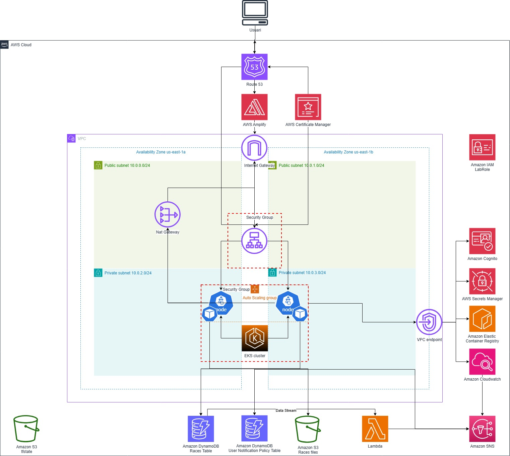

# Marathon Cloud Platform

## RESUM

### L'aplicació
L'aplicació _Marathon Cloud Platform_ és una plataforma online que permet als usuaris registrar tant curses ja disputades com curses que encara s'han de celebrar. Funciona com un arxiu comú on la comunitat pot compartir tot tipus de curses arreu del mon. Cada usuari disposa del seu propi compte, a tra´ves del qual pot afegir noves curses, consultar les que han publicat altres membres i rebre notificacions sobre les novetat de la plataforma

### Stack tecnològic

La nostra aplicació es basa en quatre pilars fonamentals.

El primer és la infraestructura cloud, construïda amb serveis d'aws i definida amb IaC amb Terraform. El segon és l'entorn de kubernetes, allotjat en un clúster eks, on s'executen els serveis de backend en contenidors. El tercer és el codi de frontend, desenvolupat en javascript i desplegat amb aws amplify, que ofereix la interfície amb la què interactuen els usuaris.El quart és el codi de backend, també en javascript, que conté la lògica i exposa la api que consumeix el frontend.

## STORYTELLING

[...]

## REQUERIMENTS I OBJECTIUS

L'objectiu del projecte es implementar una infraestructura cloud on poder allotjar la nostra aplicació, Marathon Cloud Platform. Aquesta infraestructura estarà gestionada amb eines IaC, com Terraform, i basada en metodologies GitOps.

Per assolir el nostre objectiu es necessàri definir una infraestructura resilient i coherent amb el funcionament de la nostra aplicació i intergrar els diferents components i serveis de AWS correctament per poder oferir una plataforma en condicions.

El requeriments funcionals de la nostra aplicació són:
1. Llistar i interactuar amb les diferents curses emmagatzemades dins la infraestructura cloud
2. Oferir a l'usuari la possibilitat d'incorporar noves curses a l'aplicació
3. Tindre un control centralitzat d'usuaris (sign-in, sign-up, logout)
4. Notificar als usuaris quan una nova cursa es publiqui a l'aplicació

## AWS

Per al desenvolupament del projecte hem utilitzat el Learner Lab de AWS Academy. Un aspecte importat a tindre en compte és que la gran majoria dels serveis AWS desplegats amb Terraform depenen del _LabRole_ del que disposa aquest entorn. Qualsevol execució d'aquest codi fora del Learnen Lab requereix modificacions de codi, així com definir nous permisos i rols per cadascún dels recursos corresponents.

## Github

Hem utilitzat Git com a repositori font del nostre projecte. Tot el contingut es troba dins del seu directori corresponent.

`platform`: conté les configuracions de Terraform per desplegar la infraestructura cloud necessària, així com la configuració per gestionar el clúster eks on viuen les nostres aplicacions, en aquest cas, Marathon Cloud Platform.

`marathon-app`: conté el codi font de l'aplicació marathon app. Està dividit en dos directoris, _frontend_ i _backend_.

`marathon-app/backend`: conté el codi del backend de l'aplicació marathon-app, desenvolupat amb nodejs

`marathon-app/frontend`: conté el codi del frontend de l'aplicació marathon-app, desenvolupat amb javascript i angular

`kubernetes`: conté els diferents helm charts, en aquest cas, el de l'aplicació marathon-app

`lambdas`: conté el codi de les funcions lambda desplegades amb Terraform

`docs`: conté documentació del projecte

### INFRAESTRUCTURA

La següent imatge mostra un diagrama de la infraestructura cloud utilitzada per al desenvolupament del projecte

